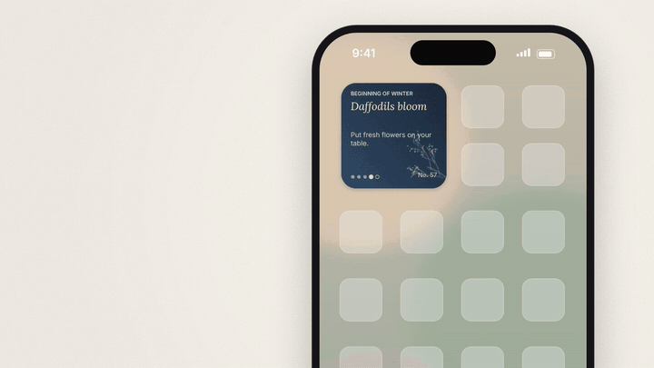
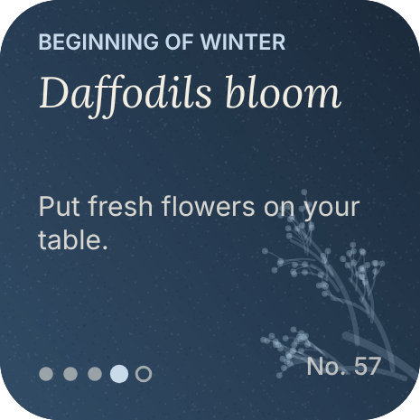
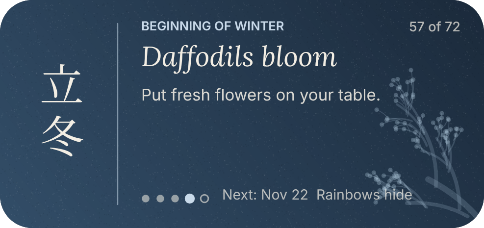
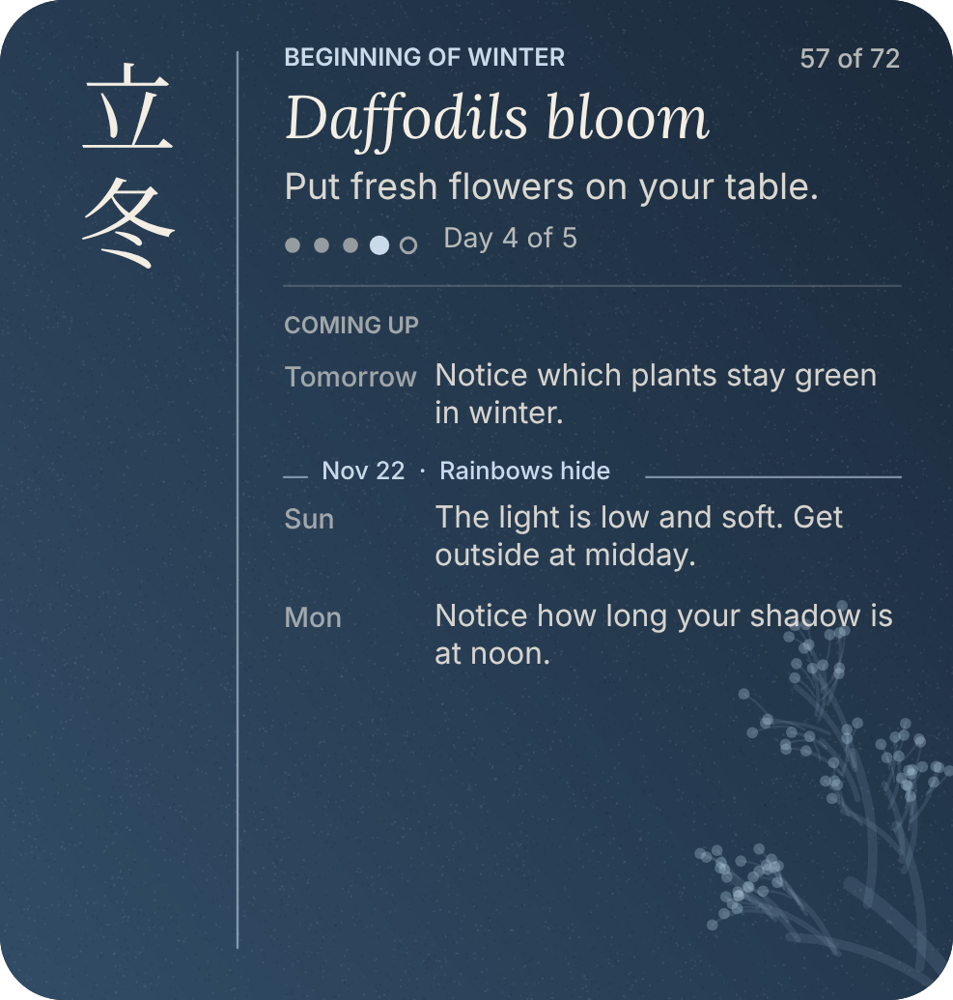

# 72 Seasons

**What if your phone told you to look up instead of scroll down?**

An iPhone widget for Japan's 72 micro-seasons. Each season lasts about five days and is named for a small change in nature: *Frogs start singing. First frost. Wild geese return.* The widget shows the one you're in, plus one small cue for your day.

Free. No app to install beyond Scriptable. No account, no tracking, no streaks.

## What it shows

| Small | Medium | Large |
| --- | --- | --- |
|  |  |  |
| The major season, today's micro-season and cue, and which day of the season it is | Adds the major season in kanji and the next micro-season | Adds cues for the next three days, with a marker when a new season begins |

Plus two Lock Screen widgets: an inline line above the clock, and a rectangular card with the season and today's cue.

The colors move with the year: ink blue in winter, plum in spring, forest in summer, rust in autumn. Each season holds its color, then eases into the next over about a month.

## Install (iPhone and iPad)

1. Install [Scriptable](https://apps.apple.com/us/app/scriptable/id1405459188) from the App Store. It's free.
2. Open [`72-Seasons.js`](72-Seasons.js), tap **Raw**, and copy all of it.
3. In Scriptable, tap **+**, paste, and name the script **72 Seasons**.
4. Long press your Home Screen, tap **Edit**, then **Add Widget**, and choose **Scriptable** in small, medium or large.
5. Long press the new widget, tap **Edit Widget**, and set **Script** to **72 Seasons**.

For the Lock Screen, add a Scriptable widget to the Lock Screen and choose 72 Seasons the same way.

More detail and fixes for common problems: [docs/INSTALL.md](docs/INSTALL.md).

## Android

Not yet. Scriptable is iOS only, so Android needs a separate build. It's planned.

## How it works

Everything runs on your phone. The script holds all 72 seasons and 432 daily cues, works out today's micro-season from the date, and draws the widget. It never goes online.

- [How it works](docs/HOW-IT-WORKS.md): dates, colors and layout.
- [Customize it](docs/CUSTOMIZE.md): change cues, colors or the branch.
- [All 72 seasons](docs/SEASONS.md), as a table.
- [`data/seasons.json`](data/seasons.json) and [`data/cues.csv`](data/cues.csv): the same data in reusable form.

## About the 72 seasons

Japan's traditional calendar divides the year into 24 major seasons (*sekki*), each split into three micro-seasons (*kō*) of about five days. The system came from China and was adapted to Japan's climate in the 1600s. The names used today come from a revision in 1874.

The names describe nature in Japan, so your weather may not match. Treat them as a nudge to notice the year turning where you are.

Start dates in this widget are fixed. The real dates can shift by a day from year to year.

## Contributing

Ideas for better cues, bug reports and translations are welcome. See [CONTRIBUTING.md](CONTRIBUTING.md).

## Credits

Designed and built by [Dhruvi Gopani](https://www.linkedin.com/in/dhruvi-gopani/). Prototyped with Claude.
Portfolio piece: [dhruvigopani.framer.website](https://dhruvigopani.framer.website/)

## License

Code: [MIT](LICENSE). Cue text and data: [CC BY 4.0](https://creativecommons.org/licenses/by/4.0/), with credit to Dhruvi Gopani.
